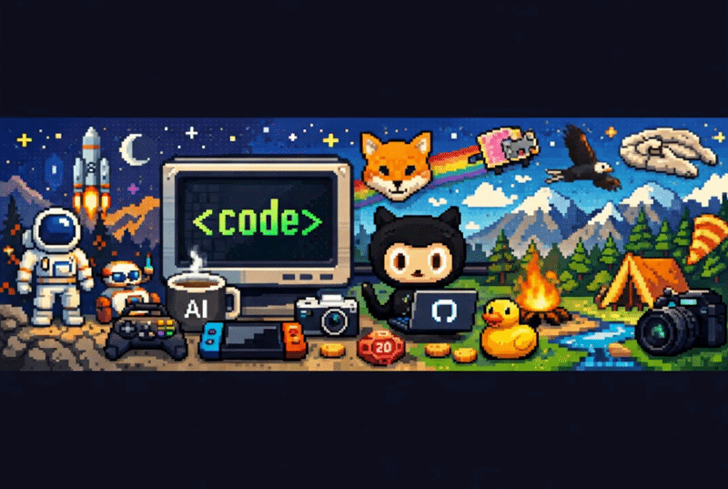

<!-- Cards are animated SVGs drawn by scripts/cards.py and refreshed daily by
     .github/workflows/update-cards.yml. Keep this block free of blank lines, and keep each row
     of three cards on one line with no spaces between them: the spacing is baked into the SVGs. -->

 
 
 
 
 
 
<picture><source media="(prefers-color-scheme: dark)" srcset="./cards/title-building-dark.svg" /></picture> 
 

<a href="https://arnav-pandey.vercel.app/">arnav-pandey.vercel.app</a> &nbsp;/&nbsp; <a href="https://linkedin.com/in/arnav-pandey-96334728a">linkedin</a> &nbsp;/&nbsp; <a href="mailto:arnav21pandey07@gmail.com">gmail</a> &nbsp;/&nbsp; <a href="https://www.kaggle.com/arnavsuiiiiiiiiiiii">kaggle</a> &nbsp;/&nbsp; <a href="https://github.com/letusnotc?tab=repositories">all repos</a>

<i>If you like my work, consider starring my repositories ⭐</i>

